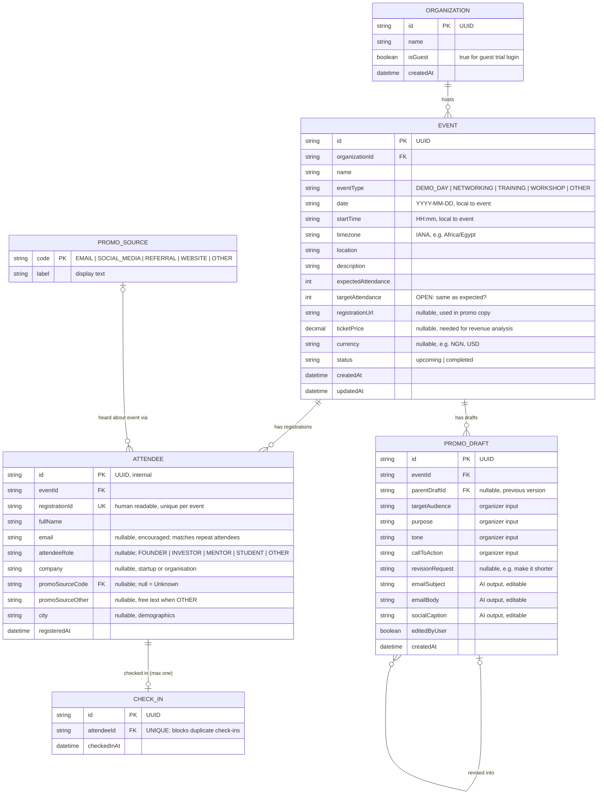

# Data Model

## Entity Relationship Diagram



## Business rules

| Rule | How the model enforces it |
|---|---|
| No duplicate check-ins | `CHECK_IN.attendeeId` is unique. A second check-in is rejected. |
| Reversible check-ins | Reversal deletes the `CHECK_IN` row. Attendee record is untouched. |
| Search by name or registration ID | `fullName` and `registrationId` are both on `ATTENDEE`. Index both. |
| Registration ID uniqueness | Unique on `(eventId, registrationId)`. Generated by the app, e.g. `EVT7-0042`. |
| Fixed promo source list | `PROMO_SOURCE` is a seeded lookup with 5 rows. Users cannot add options. |
| "Unknown" source | Not a stored option. `promoSourceCode = null` is reported as **Unknown**. |
| Promo copy must not invent details | Date, time, location and registration URL are read from `EVENT`, never generated. |
| Only completed events are compared | History and comparison screens filter on `status = completed`. |
| Like-for-like comparison | Comparison can be filtered by `eventType`, so a demo day is not judged against a training course. |
| Repeat attendees | Same person across events is matched by lowercased `email` within one organization. Attendees without email count as new. |

## Derived values (computed, never stored)

These come from queries, so they can never drift out of sync with the real data.

- **Registrations** = count of `ATTENDEE` for the event
- **Actual attendance** = count of `CHECK_IN` joined through `ATTENDEE`
- **Attendance rate** = actual attendance / registrations
- **Performance vs target** = actual attendance / `targetAttendance`
- **Turnout by source** = registrations and check-ins grouped by `promoSourceCode` (null grouped as Unknown)
- **Turnout by role** = registrations and check-ins grouped by `attendeeRole` (e.g. investors at a demo day)
- **Repeat vs new attendees** = attendees whose `email` appears in an earlier event of the same organization
- **Revenue** = registrations (or check-ins, OPEN) x `ticketPrice`; zero for free events

## TypeScript shape (storage agnostic)

```ts
export const PROMO_SOURCES = ["EMAIL", "SOCIAL_MEDIA", "REFERRAL", "WEBSITE", "OTHER"] as const;
export type PromoSourceCode = (typeof PROMO_SOURCES)[number];
export type EventStatus = "upcoming" | "completed";
export const EVENT_TYPES = ["DEMO_DAY", "NETWORKING", "TRAINING", "WORKSHOP", "OTHER"] as const;
export type EventType = (typeof EVENT_TYPES)[number];
export const ATTENDEE_ROLES = ["FOUNDER", "INVESTOR", "MENTOR", "STUDENT", "OTHER"] as const;
export type AttendeeRole = (typeof ATTENDEE_ROLES)[number];

export interface Organization { id: string; name: string; isGuest: boolean; createdAt: string; }

export interface Event {
  id: string; organizationId: string;
  name: string; eventType: EventType; date: string; startTime: string; timezone: string;
  location: string; description: string;
  expectedAttendance: number; targetAttendance: number;
  registrationUrl: string | null; ticketPrice: number | null; currency: string | null;
  status: EventStatus; createdAt: string; updatedAt: string;
}

export interface Attendee {
  id: string; eventId: string; registrationId: string; fullName: string;
  email: string | null; // encouraged: used to match repeat attendees
  attendeeRole: AttendeeRole | null; company: string | null;
  promoSourceCode: PromoSourceCode | null; // null => "Unknown" in reports
  promoSourceOther: string | null;
  city: string | null;
  registeredAt: string;
}

export interface CheckIn { id: string; attendeeId: string; checkedInAt: string; }

export interface PromoDraft {
  id: string; eventId: string; parentDraftId: string | null;
  targetAudience: string; purpose: string; tone: string; callToAction: string;
  revisionRequest: string | null;
  emailSubject: string; emailBody: string; socialCaption: string;
  editedByUser: boolean; createdAt: string;
}
```

<!-- If we use Local Storage, store a `schemaVersion` key alongside the data so we can migrate old browser data when this model changes. -->